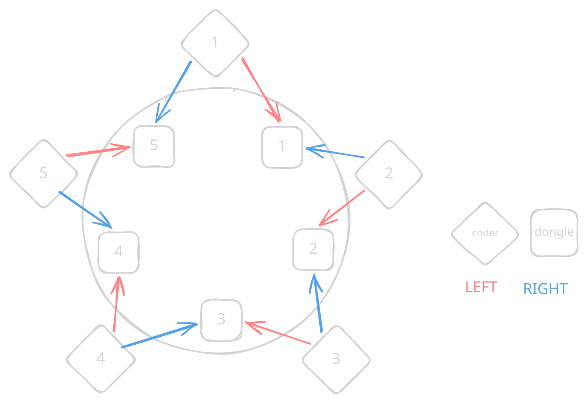

*This project has been created as part of the 42 curriculum by alvespin.*

# Codexion

<div align="center">
    
</div>
<br>

## Table of Contents

1. [Description](#description)
   - [Arguments](#arguments)
   - [Schedulers](#schedulers)
2. [Intructions](#instructions)
   - [Usage](#usage)
   - [Examples](#examples)
3. [Structure](#structure)
   - [Project Structure](#project-structure)
   - [Object Structure](#object-structure)
   - [Libraries](#libraries)
3. [Blocking cases handled](#blocking-cases-handled)
4. [Thread synchronization mechanisms](#thread-synchronization-mechanisms)
5. [Resources](#resources)
   - [Documentation](#documentation)
   - [Guides](#guides)
   - [Projects](#projects)
   - [AI](#ai)

---

## Description

This is a project is about managing POSIX Threads and the values they contain.

It is an extension of the Dining Philosophers problem, an example problem to illustrate synchronization issues and techniques for resolving them.

**Original**: 
Formulated by Edsger Dijkstra in 1965 as an exam exercise, it deals with a five philosophers dining at a table, each with their own plate, and with five forks between each one.

A philosopher needs the two forks next to them to eat from their plate. If a philosopher is not eating, they are thinking. After eating, they put down their forks and go back to thinking. If they do not eat within a certain time, they will starve.
The exercise was to design a concurrent algorithm that will allow the philosophers to indefinately alternate between eating and thinking without starving, assuming they can only be eating or thinking.

**Our version**:
In this version, instead of philosophers who need forks to eat and not starve, we are dealing with coders who need dongles to compile and not burnout. But there's more.

Once they are done debugging and have put down both dongles, a coder will refactor their code. And once they have refactoreing they will need to compile again. This is not indefinate, as we have a number of compiles required for each coder. The dongles have a cooldown after being used where they cannot be grabbed again.

Aside from that, the conflict between the coders' demands will be handled by two possible schedulers: FIFO and EDF.

#### Arguments

|Name|Description|Value|
|--|--|--|
| `number_of_coders` | Number of coders and dongles in the program. | integer >= 1 |
| `time_to_burnout` | Time it takes for a coder to burnout. | long integer >= 1 |
| `time_to_compile` | Time it takes for a coder to compile. | long integer >= 1 |
| `time_to_debug` | Time it takes for a coder to debug. | long >= 1 |
| `time_to_refactor` | Time it takes for a coder to refactor. | long >= 1 |
| `dongle_cooldown` | Time it takes for a dongle to become available after use. | long >= 1 |
| `number_of_compiles_required` | Amount of times a coder must compile before the program ends. | integer >= 1 |
| `scheduler` | Type of scheduler used to distribute dongles. | 'fifo' / 'edf' |

#### Schedulers

- **FIFO (First In, First Out)**: the dongle will be given to the coder that asked for it first.
- **EDF (Earliest Deadline First)**: the dongle will be given to the coder with the shortest deadline to burnout (last_compile + time_to_burnout).

## Instructions

#### Usage

In order to create the executable, run this on the coders/ directory.
```bash
make
```

To run the executable, you will need ro provide the all the arguments described:
```bash
./codexion <n_coders> <time_to_burnout> <time_to_compile> <time_to_debug> <time_to_cooldown> <n_compiles> <time_to_refactor> <scheduler>
```

**Remember**: In order for the coders to not burn out this rule must be obeyed:

`time_to_burnout` > (`time_to_compile` + `time_to_debug` + `time_to_refactor` + `dongle_cooldown`)

The bigger the difference the least likely burnout becomes.

#### Examples
```bash
./codexion 6 400 100 100 100 3 20 edf
./codexion 4 500 100 100 100 4 20 fifo
./codexion 5 400 100 100 100 2 10 fifo
./codexion 5 800 200 200 200 2 15 edf
./codexion 1 800 200 200 200 2 15 edf

./codexion 5 340 100 100 10 10 10 edf   # Stress test for edf
```


## Structure

#### Project Structure

```
codexion/
├── coders/
│   ├── include/
│   │   └── codexion.h
│   └── src/
│       ├── coder_actions.c
│       ├── coder_utils.c
│       ├── dongles.c
│       ├── monitor.c
│       ├── main.c
│       ├── cleanup.c
│       ├── parser.c
│       ├── setup_1.c
│       ├── setup_2.c
│       ├── utils_1.c
│       └── utils_2.c
├── Makefile
├── README.md
├── schema.svg
└── .gitignore
```

#### Object Structure

**Coder**

|<div style="width:135px">Name</div>|Type|Description|
|--|:--|:--|
|id | int | ID of the coder.|
|n_compiles | int | Number of compiles done.|
|last_compile_time | long | Last time a compile was done.|
|thread | pthread_t | Thread that runs the coder routine.|
|lock | pthread_mutex_t | Protects ... .|
|dongle_l | t_dongle* | Dongle to the left of the coder.|
|dongle_r | t_dongle* | Dongle to the right of the coder.|
|hub | t_hub* | Pointer to the hub.|

**Dongle**

|<div style="width:135px"></div>|||
|--|--|--|
|is_available | int | 1 is the dongle is available, 0 if it's not. |
|last_used_time | long | Time at which the dongle was last used. |
|lock | pthread_mutex_t | ... |
|cond | pthread_cond_t | ... |
|heap | t_heap | Heap of the dongle.|

**Hub**

|<div style="width:135px"></div>|||
|--|--|--|
|n_coders | int | `number_of_coders` |
|burnout_time | long | `time_to_burnout` |
|compile_time | long | `time_to_compile` |
|debug_time | long | `time_to_debug` |
|refactor_time | long | `time_to_refactor` |
|n_compiles_required | int | `number_of_compiles_required` |
|cooldown | long | `dongle_cooldown` |
|scheduler | t_scheduler | `scheduler` |
|start_flag | int | Shared flag to start the execution.|
|stop_flag | int | Shared flag to stop the execution.|
|ready_count | int | Amount of actors ready to start the execution.|
|start_time | long | Time that the execution starts.|
|lock | pthread_mutex_t | Protects ... .|
|stop_lock | pthread_mutex_t | Protects the stop flag.|
|log_lock | pthread_mutex_t | Protects the printf inside log_status().|
|dongles | t_dongle* | Array of dongles in the program.|
|coders| t_coder* | Array of coders in the program.|

**Heap**

Every dongle contains a heap of requests, and can have at 2 at most.<br>
A request is made up of the ID of the coder that makes the request and a value.<br>
This value will be different depending on the scheduler.
The request with the lowest value will always be at the top of the heap.

#### Libraries

```c
#include <pthread.h>   // for POSIX threads
#include <sys/time.h>	// for struct timeval
#include <unistd.h>	// for usleep()
#include <stdio.h>	// for printf()
#include <stdlib.h>	// for atoi(), NULL
#include <string.h>	// for strcmp()
#include <limits.h> // for INT_MAX, INT_MIN
```

## Blocking cases handled

|

## Thread synchronization mechanisms

|

## Resources

#### Documentation

- https://www.doxygen.nl/manual/docblocks.html#cppblock
- https://gcc.gnu.org/onlinedocs/cpp/Object-like-Macros.html
- https://www.man7.org/linux/man-pages/man3/usleep.3.html
- https://www.man7.org/linux/man-pages/man2/gettimeofday.2.html

#### Guides

- https://www.geeksforgeeks.org/c/multithreading-in-c/
- https://www.geeksforgeeks.org/operating-systems/reader-writer-problem-using-monitors-pthreads/

#### Projects

- https://github.com/furkangny/Philosophers
- https://github.com/jleiva-g/philosophers/
- https://github.com/browser22nd/codexion
- https://github.com/SaraFreitas-dev/Codexion

#### AI

The AI chatbot Claude was used incedentally to resolve and explain especific errors and unwanted results. No code was provided.
